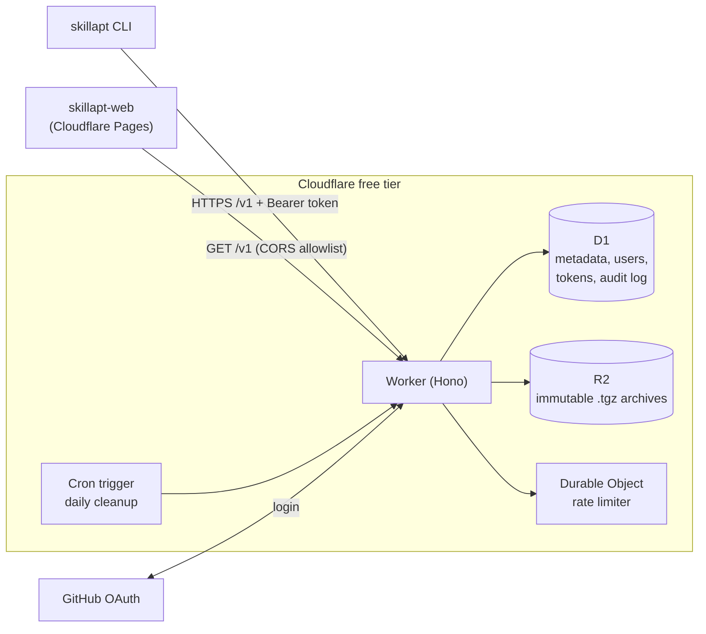

# skillapt-registry

**The package registry behind [skillapt](https://github.com/Ankur17nith/skillapt): publish, discover and install AI agent skills with integrity guarantees. Runs entirely on Cloudflare's free tier.**

[](https://github.com/Ankur17nith/skillapt-registry/actions/workflows/ci.yml)
[](LICENSE)
[](https://nodejs.org/)
[](https://workers.cloudflare.com/)

skillapt is a package manager for **AI agent skills** (folders of instructions, prompts and helper files for Claude, Cursor, Codex, Antigravity and custom agents). This repository is the **registry service**: the HTTP API the `skillapt` CLI talks to, built with TypeScript and [Hono](https://hono.dev/) on Cloudflare Workers, D1 (SQLite) and R2 (object storage).

> **Status.** The code is complete and covered by tests, but **no public instance is deployed yet**, and there is no registry domain. You deploy your own instance for free on a `*.workers.dev` address by following [`docs/DEPLOY.md`](docs/DEPLOY.md). Any hostname you see in examples is a placeholder.

## The skillapt project

| Repository | Purpose |
| :--- | :--- |
| [`skillapt`](https://github.com/Ankur17nith/skillapt) | The CLI (`npx skillapt ...`): init, pack, install, publish, lockfile |
| **`skillapt-registry`** (this repo) | The registry API: storage, search, auth, moderation |
| [`skillapt-web`](https://github.com/Ankur17nith/skillapt-web) | The website: browse and search skills |



## Features

- **Immutable releases.** A published version can never be changed. R2 writes are create-only and D1 metadata is written in one atomic batch; republishing returns `409`.
- **Strict package validation.** Archives must be `.tar.gz` (5 MB compressed, 25 MB uncompressed, 500 files). Paths are normalized and checked (no symlinks, hardlinks, `..`, absolute or hidden paths, no duplicates), file types are allow-listed, and executables (ELF, Mach-O, PE, Java class, WASM) are rejected by magic bytes. A valid `SKILL.md` and `skill.json` are mandatory.
- **Integrity everywhere.** SHA-256 digests (`sha256-<hex>`) are computed at publish time, served in metadata and as the `ETag`, and checked by the CLI against its lockfile.
- **Ownership and scopes.** Unscoped names are first-come; `@scope/name` packages are tied to the owning GitHub account.
- **Yank and takedown.** Owners yank bad versions (hidden from ranges, still downloadable for existing lockfiles). Admins remove versions entirely (`410 Gone`) with an audit log entry.
- **Safe authentication.** GitHub OAuth for the web dashboard (HTTP-only, `Secure`, `SameSite=Lax` cookies, CSRF checks), and hashed personal access tokens (`apt_live_...`, 90-day default expiry) for the CLI. Only SHA-256 hashes are stored.
- **Abuse resistance.** Sliding-window rate limits on a Durable Object (fails open if the limiter is unavailable), body-size caps, salted IP hashing for download de-duplication and abuse reports.
- **Operable.** A read-only `MAINTENANCE_MODE`, a daily cleanup cron, a post-deploy verification script and a runbook.

## API overview

Everything lives under `/v1` (plus the server-rendered token dashboard at `/dashboard`).

| Method | Endpoint | Description | Auth |
| :--- | :--- | :--- | :--- |
| `GET` | `/v1/health` | Health check | Public |
| `GET` | `/v1/skills` | Search, filter and list skills (paginated) | Public |
| `GET` | `/v1/skills/:name` | Skill details, readme, versions | Public |
| `GET` | `/v1/skills/:name/:version` | Version metadata and integrity hash | Public |
| `GET` | `/v1/skills/:name/-/:version.tgz` | Download a package | Public |
| `POST` | `/v1/skills` | Publish a package (`multipart/form-data` or `application/gzip`) | Token / session |
| `POST` / `DELETE` | `/v1/skills/:name/:version/yank` | Yank / un-yank a version | Owner |
| `POST` | `/v1/admin/skills/:name/:version/takedown` \| `restore` | Remove / restore a version | Admin |
| `GET` | `/v1/admin/reports` | List abuse reports | Admin |
| `POST` | `/v1/admin/reports/:id/resolve` | Resolve a report | Admin |
| `POST` | `/v1/reports` | Report a skill | Public (rate-limited) |
| `GET` | `/v1/me` | Current user | Token / session |
| `GET` / `POST` / `DELETE` | `/v1/tokens`, `/v1/tokens/:id` | Manage API tokens | Session |
| `GET` | `/v1/auth/github` (+ `/callback`) | GitHub OAuth login | Public |
| `POST` | `/v1/auth/logout` | End the session | Session |
| `GET` | `/v1/stats` | Registry totals | Public |

Scoped names are URL-encoded in paths (`@alice/tool` becomes `%40alice%2Ftool`). Full request and response schemas: [`docs/openapi.yaml`](docs/openapi.yaml) and [`docs/SPEC.md`](docs/SPEC.md).

## Quick start (local development)

You need Node.js **>= 22.5** and [pnpm](https://pnpm.io/).

```bash
git clone https://github.com/Ankur17nith/skillapt-registry.git
cd skillapt-registry
pnpm install --frozen-lockfile

cp .dev.vars.example .dev.vars        # then fill in GitHub OAuth values (optional for API-only work)
pnpm db:migrate:local                 # create the local D1 database
pnpm db:seed:local                    # optional: sample skills
pnpm dev                              # http://localhost:8787
```

```bash
curl -s http://localhost:8787/v1/health
curl -s "http://localhost:8787/v1/skills?q=pdf"
```

For GitHub login locally, create an OAuth app with the callback `http://localhost:8787/v1/auth/github/callback` and put its credentials in `.dev.vars`.

### Publish a package

```bash
curl -X POST http://localhost:8787/v1/skills \
  -H "Authorization: Bearer <YOUR_API_TOKEN>" \
  -F "file=@my-skill.tar.gz"
```

Or use the CLI: `export SKILLAPT_REGISTRY=http://localhost:8787` then `skillapt publish`.

## Configuration

| Name | Kind | Required | Description |
| :--- | :--- | :--- | :--- |
| `ENVIRONMENT` | var | yes | `production` (default in `wrangler.jsonc`), or `development` / `test` locally. **Any other or missing value is treated as production** (HTTPS-only cookies, no localhost origins, masked errors). |
| `PUBLIC_ORIGIN` | var | recommended | The registry's own public URL, used for same-origin CSRF checks. |
| `CORS_ORIGIN` | var | for browsers | Exact, comma-separated origins allowed to call the API cross-origin (e.g. the Pages site). `*` is rejected; localhost is ignored in production; empty allows none. |
| `MAINTENANCE_MODE` | var | no | `true` rejects all writes with `503` while reads keep working. |
| `GITHUB_CLIENT_ID` | secret | for login | GitHub OAuth app client id. |
| `GITHUB_CLIENT_SECRET` | secret | for login | GitHub OAuth app client secret. |
| `HASH_SALT` | secret | yes | Salt for hashing client IPs (`REPORT_SALT` is accepted as a legacy name). |

Secrets are set with `npx wrangler secret put <NAME>` (production) or in the git-ignored `.dev.vars` (local). Never commit them.

## Deploy for free on Cloudflare

No domain and no paid plan are needed. In short:

```bash
npx wrangler login
npx wrangler d1 create skillapt-db              # paste the id into wrangler.jsonc
npx wrangler r2 bucket create skillapt-packages
npx wrangler d1 migrations apply DB --remote
npx wrangler secret put GITHUB_CLIENT_ID
npx wrangler secret put GITHUB_CLIENT_SECRET
npx wrangler secret put HASH_SALT
npx wrangler deploy                             # -> https://skillapt-registry.<you>.workers.dev
```

The full walkthrough, free-tier limits (R2 needs a card on file; the free Workers plan allows 10 ms CPU per request, so very large publishes may need a paid plan) and troubleshooting are in [`docs/DEPLOY.md`](docs/DEPLOY.md). Day-2 operations (takedowns, backups, key rotation, maintenance mode) are in [`docs/RUNBOOK.md`](docs/RUNBOOK.md).

## Security model

- **The registry never executes package code.** Archives are inspected statically and served as opaque files.
- **Defense in depth on uploads:** size caps enforced while streaming, zip-bomb protection, tar parsing that cannot be desynchronised from real extractors (PAX sizes are honored), path and type allow-lists, magic-byte checks.
- **Secrets at rest:** API tokens and sessions are stored only as SHA-256 hashes; the token is shown once. Client IPs are only stored as salted hashes.
- **Web safety:** strict CSP (`default-src 'none'`), HSTS, `X-Frame-Options: DENY`, exact-match CORS allowlist, per-session CSRF tokens on the dashboard, Origin/Referer checks for cookie-authenticated API writes, and no secrets in URLs.
- **Fail safe:** a misconfigured environment is treated as production, and the rate limiter fails open rather than taking the API down.

To report a vulnerability privately, see [`SECURITY.md`](SECURITY.md).

## Testing

```bash
pnpm typecheck           # TypeScript
pnpm test                # ~180 unit and integration tests (in-memory D1/R2 mocks)
pnpm audit --prod        # dependency advisories
pnpm smoke               # boots the Worker on local workerd, checks /v1/health
pnpm test:integration    # 14 end-to-end scenarios on workerd with local D1, R2 and Durable Objects
pnpm conformance         # drives the real skillapt CLI against this registry (set SKILLAPT_CLI_DIR)
```

`pnpm conformance` needs a built checkout of the [CLI](https://github.com/Ankur17nith/skillapt) (`SKILLAPT_CLI_DIR=/path/to/skillapt`). CI runs everything above in [`.github/workflows/ci.yml`](.github/workflows/ci.yml).

## Project layout

```
src/
  index.ts            app wiring: headers, CORS, rate limit, routes, cron handler
  routes/             skills, auth, tokens, admin, reports, stats, dashboard
  middleware/         authentication + CSRF, rate limiting
  validation/         tar archive inspection, manifest schema (zod)
  rate-limiter/       Durable Object + in-memory limiter
  utils/              crypto, environment, IP-hash salt
migrations/           D1 schema (0001-0005)
tests/                vitest suites (security regressions in tests/security)
scripts/              smoke, integration, conformance, post-deploy check
docs/                 SPEC, OpenAPI, DEPLOY, RUNBOOK
```

## Contributing

Contributions are welcome. Please read [`CONTRIBUTING.md`](CONTRIBUTING.md) and the [Code of Conduct](CODE_OF_CONDUCT.md) first.

## License

[MIT](LICENSE) © 2026 skillapt contributors
