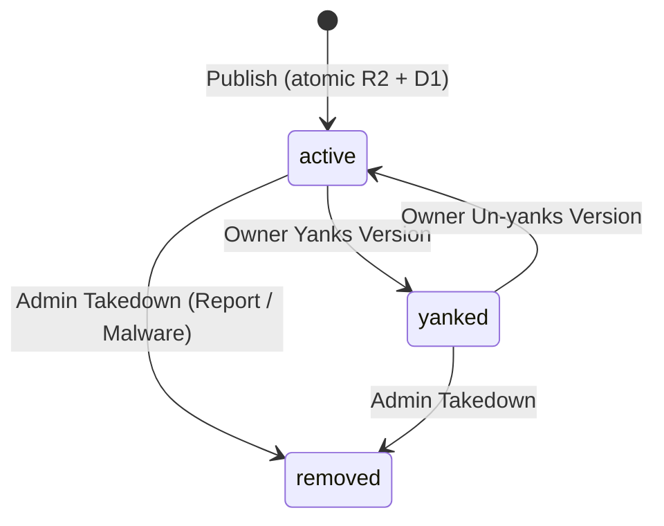
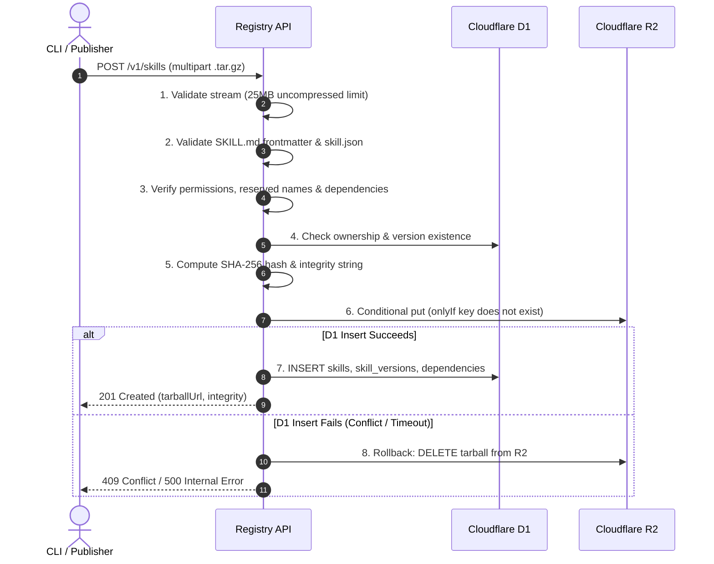

# Skillapt Registry Specification

> **Version**: 1.1.0  
> **Status**: Approved Specification for Registry, CLI, and Web UI  
> **Target Platform**: Cloudflare Workers (TypeScript, Hono, D1 SQLite, R2 Object Storage)  
> **Branding Rule**: The product name lives in exactly one constant: `PRODUCT_NAME = "skillapt"` in `src/config.ts`.

---

## 1. Overview & Vision

`skillapt` is an independent, secure package manager and package registry built specifically for **AI agent skills**.

An **agent skill** is a modular package that teaches an AI agent (such as Claude, Cursor, Codex, Antigravity, or custom LLM frameworks) how to perform specialized tasks. Skills provide instructions, prompt templates, schemas, and helper scripts that agents consume to accomplish workflows like document summarization, database queries, code refactoring, or security auditing.

`skillapt` is **completely independent of npm**. It does not use npm packages, npm registries, `node_modules`, or npm lifecycle scripts. It provides a lightweight, sandboxed distribution format tailored for modern agentic AI architectures.

### Core Architecture Principles
1. **Zero Code Execution on Registry**: The registry never executes, builds, runs, or evaluates user code. Packages are inspected statically and served as static tarballs.
2. **Immutable Releases & Atomicity**: Once published, a version's tarball and metadata are frozen forever. Releases are atomic: tarball storage and database records are synchronized with complete rollback on failure. Build metadata (`+...`) is strictly rejected.
3. **Explicit Declarations**: Every skill declares its permissions (network, shell, filesystem). These are declarations for user and agent awareness, not kernel-level enforcements.
4. **Deterministic Resolution**: Semantic Versioning (SemVer 2.0.0) resolution skipping yanked and removed versions, backed by deterministic lockfiles (`skills.lock.json`) with standard `integrity` (`sha256-<hex>`) hashes. Flat installs prevent dependency hell.
5. **Edge-Native Performance**: Powered by Cloudflare Workers (compute at the edge), Cloudflare D1 (relational metadata), Cloudflare R2 (immutable tarball storage), and Cloudflare native Rate Limiting.

---

## 2. Threat Model & Security Posture

AI agent skill packages introduce threat vectors distinct from traditional software dependencies. Because skills are interpreted by Large Language Models and agent runtimes, security requires clear boundaries and defense-in-depth.

### 2.1 Threat Vectors

| Threat | Description | Registry Mitigation | Runtime / Client Mitigation |
| :--- | :--- | :--- | :--- |
| **Prompt Injection** | Adversarial instructions hidden inside `SKILL.md` or templates designed to hijack agent system prompts, leak system contexts, or bypass agent guardrails. | Static text inspection, UTF-8 normalization, required standard YAML frontmatter, community abuse reporting (`POST /v1/reports`). | Agents must treat unverified skill documentation as untrusted user input, isolate system instructions, and enforce prompt delimiters. |
| **Malicious Scripts** | Executable shell, Python, or JavaScript scripts designed to steal environment keys (`.env`, AWS/OpenAI tokens) or execute system commands. | Strict ban on binary executables (`.exe`, ELF, Mach-O, `.dll`, `.so`). Explicit permission declaration required in `skill.json`. Static extension and file structure validation. | Agent environments must run helper scripts inside ephemeral sandboxes (e.g. gVisor, Docker, WebAssembly) with restricted permissions. |
| **Permission Under-declaration** | A skill declares `network: false` but its script attempts socket connections. | Declarations are verified against community reports; false declarations result in immediate admin takedown (`removed` status). | Runtimes must enforce declared permissions via OS sandbox profiles rather than relying on trust. |
| **Typosquatting & Impersonation** | Registering names resembling popular skills (e.g., `pdf-summarizer` vs `pdf-summarizerr`) or impersonating official vendor packages. | Reserved names list (`skillapt`, `admin`, `claude`, `openai`, etc.), strict GitHub-scoped ownership (`@handle/name`), verified badges for authenticated repositories, and typosquat reporting. | CLI warns on newly published packages and flags unverified publishers. |
| **Decompression Bombs (Zip Bombs)** | Small `.tar.gz` archives expanding into hundreds of gigabytes to exhaust memory or disk space. | Strict upload limit (5 MB compressed) and **streaming decompression aborting at 25 MB** before memory allocation. Maximum 500 files. | CLI applies identical streaming decompression limits locally before unpacking. |
| **Path Traversal & Overwrite** | Tar archives containing `../`, absolute paths, symlinks, or duplicate filenames attempting to overwrite critical host files. | Tarball parser strictly forbids `..`, absolute paths, Windows drive letters, symlinks, hardlinks, and duplicate paths. | CLI validates all paths prior to writing to the project skills directory. |

### 2.2 Permissions Are Declarations, Not Enforcement
> [!IMPORTANT]
> The `permissions` object in `skill.json` represents the author's **declared capability requirements**. The registry verifies that the declaration is well-formed, but the registry **does not and cannot enforce runtime constraints** during agent execution. Client CLI tools, IDE plugins, and agent hosts are responsible for reading `permissions` and configuring sandboxed environments (e.g. disabling container networking if `network: false`).

---

## 3. Package Format & Archive Rules

Every skill package is distributed as a gzip-compressed tar archive (`.tar.gz` or `.tgz`).

### 3.1 Archive Layout

```text
<package-name>/               # Optional root directory (normalized automatically)
├── skill.json                # Required: Package manifest
├── SKILL.md                  # Required: Agent documentation with standard YAML frontmatter
└── ...                       # Optional: Prompts, templates, schemas, and helper scripts
```

### 3.2 Required Files & Specifications

#### 1. `SKILL.md` (Agent Skills Open Standard)
`SKILL.md` is the primary interface between the package and the consuming AI agent. It **MUST** begin with valid YAML frontmatter demarcated by triple dashes (`---`).

- **Required Frontmatter Keys**:
  - `name`: Must match the **unscoped** package name specified in `skill.json` (e.g. for package `@alice/pdf-tool`, frontmatter `name` must be `pdf-tool`).
  - `description`: A clear, single-sentence summary of what the skill enables for the agent.
- **Content Limits**:
  - Minimum size: 10 non-whitespace characters.
  - Maximum size: 256 KB (262,144 bytes). Prevents context-window flooding and D1 database bloat.
- **Example `SKILL.md`**:
```markdown
---
name: pdf-summarizer
description: Extracts text from PDF files and generates structured summaries.
category: documents
version: 1.2.0
---

# PDF Summarizer Skill

## Capabilities
- Extracts raw text and metadata from PDF files up to 50 MB.
- Generates section-by-section summaries formatted in GitHub Markdown.

## Usage Guidelines
When the user asks to summarize a PDF, inspect the document outline first...
```

#### 2. `skill.json` (Package Manifest)
The authoring manifest defining metadata, dependencies, and capabilities. Detailed schema is defined in [Section 4](#4-package-manifest-skilljson).

### 3.3 Allowed File Types & Content Verification

The registry inspects all entries in the tarball. Only safe, text-based, template, and script formats are allowed:

| Category | Allowed File Extensions |
| :--- | :--- |
| **Documentation & Prompts** | `.md`, `.txt`, `.prompt`, `.rst` |
| **Data & Configuration** | `.json`, `.yaml`, `.yml`, `.toml`, `.csv`, `.tsv`, `.xml`, `.xsd` |
| **Web Assets** | `.html`, `.css`, `.svg` |
| **Templates** | `.jinja`, `.jinja2`, `.mustache`, `.hbs`, `.template` |
| **Common Scripts** | `.js`, `.mjs`, `.cjs`, `.ts`, `.py`, `.sh`, `.bash`, `.zsh`, `.lua`, `.rb` |
| **Allowed Special Dotfiles** | `.gitignore`, `.editorconfig` |
| **Allowed Extensionless Files** | `LICENSE`, `NOTICE`, `README`, `CHANGELOG`, `Makefile` |

**Strictly Prohibited & Rejected**:
- **Binary Executables & Libraries**: `.exe`, `.dll`, `.so`, `.dylib`, `.bin`, `.elf`, `.macho`, `.com`.
- **Content Signature Checking**: The registry inspects the initial 512 bytes of every file. Any file matching ELF (`0x7F 0x45 0x4C 0x46`), Mach-O (`0xFE 0xED 0xFA 0xCE/CF` or `0xCF 0xFA 0xED 0xFE` or universal fat binary `0xCA 0xFE 0xBA 0xBE`), Windows PE (`MZ` / `0x4D 0x5A`), Java class, or WebAssembly (`\0asm` / `0x00 0x61 0x73 0x6D`) magic bytes is **rejected immediately**, even if disguised with a `.py` or `.txt` extension.
- **Nested Archives**: `.tar`, `.gz`, `.zip`, `.rar`, `.7z`, `.bz2`.
- **Hidden Files & Directories**: Any file or directory with any path segment starting with `.` other than `.gitignore` and `.editorconfig`.

### 3.4 Archive Safety Constraints & Streaming Limits

| Constraint | Limit | Implementation Requirement |
| :--- | :--- | :--- |
| **Compressed Upload Limit** | **5 MB** (5,242,880 bytes) | Enforced via HTTP `Content-Length` and multipart body stream. |
| **Uncompressed Total Limit** | **25 MB** (26,214,400 bytes) | **Enforced strictly WHILE streaming** through `DecompressionStream("gzip")`. The reader aborts immediately when cumulative chunk bytes exceed 25 MB. Never buffered into memory. |
| **Max File Count** | **500 entries** | Aborts parsing if file count exceeds 500. |
| **Max Path Length** | **255 characters** | Rejects entries with path length > 255. |
| **Path Traversal (`..`)** | Forbidden | Any entry containing `..` as a path segment is rejected. |
| **Absolute Paths** | Forbidden | Any path starting with `/`, `\`, or Windows drive letters (e.g. `C:`) is rejected. |
| **Duplicate Paths** | Forbidden | The unpacker maintains a set of seen paths. Duplicate paths (including case-insensitive and Unicode NFC collisions) trigger immediate rejection. |
| **Unicode Normalization** | NFC Required | Paths are normalized via UTF-8 NFC. Collisions between decomposed and precomposed representations are blocked. |
| **Header Types** | Regular/Dir Only | Type flags other than `'0'` (regular file), `'\0'`, and `'5'` (directory) are rejected (symlinks `'2'`, hardlinks `'1'`, devices `'3'`/`'4'`/`'6'` are blocked). PAX (`'x'`, `'g'`) and GNU (`'L'`, `'K'`) headers are safely handled as metadata or rejected if malformed. |

---

## 4. Package Manifest (`skill.json`)

The package manifest lives inside the archive root and governs package distribution.

```json
{
  "name": "pdf-summarizer",
  "version": "1.2.0",
  "description": "Extracts text from PDF documents and generates structured agent summaries.",
  "license": "MIT",
  "repository": "https://github.com/agent-skills/pdf-summarizer",
  "keywords": ["pdf", "summarizer", "documents", "extraction"],
  "category": "documents",
  "compatibility": ["claude", "cursor", "codex", "antigravity"],
  "dependencies": {
    "text-cleaner": "^1.0.0"
  },
  "permissions": {
    "network": false,
    "shell": false,
    "filesystem": "read"
  }
}
```

### 4.1 Field Rules & Validation Matrix

| Field | Type | Required | Specification & Validation Rules |
| :--- | :--- | :--- | :--- |
| `name` | `string` | **Yes** | 3 to 50 characters. Lowercase letters (`a-z`), digits (`0-9`), and hyphens (`-`). Cannot start or end with a hyphen. May optionally have a scope prefix: `@<handle>/<name>`. Regex: `^(@[a-z0-9-]{2,30}\/)?[a-z0-9][a-z0-9-]{1,48}[a-z0-9]$`. Must not be in the [Reserved Names](#53-reserved-names-list) list. |
| `version` | `string` | **Yes** | Strict Semantic Versioning 2.0.0 (e.g. `1.0.0`, `2.1.0-beta.1`). **Build metadata (`+...`) is strictly rejected** to ensure release immutability and unambiguous version precedence. |
| `description` | `string` | **Yes** | 10 to 300 characters. Plain text summary. |
| `license` | `string` | **Yes** | Valid SPDX license identifier (e.g. `MIT`, `Apache-2.0`, `ISC`) or `UNLICENSED`. Max 50 characters. |
| `repository` | `string` | No | Valid HTTP/HTTPS repository URL (e.g. `https://github.com/org/repo`). Required for verified badge. |
| `keywords` | `string[]` | No | Up to 10 strings. Lowercase alphanumeric and hyphens, 2–30 chars each. |
| `category` | `string` | **Yes** | One of: `documents`, `coding`, `research`, `data`, `devtools`, `communication`, `productivity`, `other`. |
| `compatibility` | `string[]` | **Yes** | 1 to 20 strings. Valid targets: `claude`, `cursor`, `codex`, `antigravity`, `openai`, `custom`. |
| `dependencies` | `object` | No | Key-value mapping of dependency skill name to valid SemVer range (e.g. `^1.0.0`, `~2.1.0`, `>=1.0.0 <2.0.0`). Max 50 dependencies. Every dependency must satisfy the [Dependency Rules](#7-dependency-resolution--install-model). |
| `permissions` | `object` | **Yes** | Capability declarations: <br>• `network`: `boolean`<br>• `shell`: `boolean`<br>• `filesystem`: `"none"` \| `"read"` \| `"write"` \| `"read-write"` |

---

## 5. Naming, Scopes, & Ownership

### 5.1 Scopes (`@handle/name`)
In `skillapt` v1, scopes are strictly bound to GitHub usernames and organization handles:
- A scoped package MUST follow the pattern `@<handle>/<name>`.
- The scope `@<handle>` matches the authenticated user's GitHub login handle (case-insensitive).
- **Enforcement**: Only user `@alice` can publish `@alice/my-skill`. An attempt by user `@bob` to publish under `@alice/*` returns `403 FORBIDDEN`.
- Organization scopes: Allowed if the user is a verified public member or owner of that GitHub organization.

### 5.2 Unscoped Packages (First-Come, First-Served)
- Unscoped packages (e.g. `pdf-summarizer`) are owned by whichever authenticated user successfully publishes version 1 first.
- Subsequent releases of that unscoped package can only be published by that owner or designated maintainers.

### 5.3 Reserved Names List
The following names are strictly reserved by the registry and **cannot be registered** as unscoped packages:

```text
skillapt, admin, api, www, official, registry, support, security, root,
claude, openai, anthropic, cursor, codex, antigravity, gemini, chatgpt,
null, undefined, core, internal, system, auth, account, dashboard
```

Any attempt to publish a package using a reserved name returns `400 BAD_REQUEST` with code `RESERVED_NAME`.

### 5.4 Typosquatting & Impersonation Policy
Users may submit abuse reports via `POST /v1/reports` using the reason code `typosquat`. If an unscoped package closely resembles an existing high-reputation skill (evaluated via Levenshtein distance $\le 2$ or phonetics) without legitimate distinction, registry administrators will review and take down the offending package under the Admin Takedown procedure.

### 5.5 Verified Publisher Status (`verified: true`)
A package displays `verified: true` in metadata and search results if and only if:
1. The publisher account is authenticated via GitHub OAuth.
2. The `repository` field in `skill.json` points to a valid GitHub repository owned by the publisher's GitHub account or an organization where the publisher is a public member.
3. For scoped packages `@handle/name`, the handle directly matches the verified GitHub account.

---

## 6. Consumer Project Files (`skills.json` and `skills.lock.json`)

Consumer repositories (projects that consume skills for their AI agents) use standard JSON configuration files in the root directory.

### 6.1 Consumer Manifest (`skills.json`)
The consumer manifest declares the project's direct skill dependencies:

```json
{
  "name": "my-agent-workspace",
  "version": "1.0.0",
  "description": "Customer support AI agent configuration",
  "skills": {
    "pdf-summarizer": "^1.2.0",
    "@acme/ticket-classifier": "~2.0.0",
    "text-cleaner": "1.0.2"
  }
}
```

- `name`: Name of the consumer workspace (string).
- `skills`: Object mapping skill package name to required SemVer range.

### 6.2 Consumer Lockfile (`skills.lock.json`)
The lockfile guarantees deterministic, reproducible installations across developer workstations and CI/CD pipelines.

```json
{
  "lockfileVersion": 1,
  "skills": {
    "pdf-summarizer": {
      "version": "1.2.0",
      "resolved": "https://registry.skillapt.dev/v1/skills/pdf-summarizer/-/1.2.0.tgz",
      "integrity": "sha256-e3b0c44298fc1c149afbf4c8996fb92427ae41e4649b934ca495991b7852b855",
      "sha256": "e3b0c44298fc1c149afbf4c8996fb92427ae41e4649b934ca495991b7852b855",
      "category": "documents",
      "permissions": {
        "network": false,
        "shell": false,
        "filesystem": "read"
      },
      "dependencies": {
        "text-cleaner": "^1.0.0"
      }
    },
    "text-cleaner": {
      "version": "1.0.2",
      "resolved": "https://registry.skillapt.dev/v1/skills/text-cleaner/-/1.0.2.tgz",
      "integrity": "sha256-7d8312d8a427f71b9e0787389278918237abc091823481298471209348123049",
      "sha256": "7d8312d8a427f71b9e0787389278918237abc091823481298471209348123049",
      "category": "data",
      "permissions": {
        "network": false,
        "shell": false,
        "filesystem": "none"
      },
      "dependencies": {}
    }
  }
}
```

### 6.3 Integrity Field Standard
- **Format**: `sha256-<hex-digest>` (e.g. `sha256-e3b0c442...`).
- Both `integrity` (`sha256-<hex>`) and `sha256` (`<hex>`) are returned by the registry API across all version endpoints and stored in `skills.lock.json`.
- The CLI MUST verify `SHA-256(tarball_bytes) === integrity` before unpacking. If the checksum does not match, the installation aborts with an integrity error.

---

## 7. Dependency Resolution & Install Model

`skillapt` employs a **flat dependency model** designed for agent prompt simplicity:

### 7.1 Rules & Constraints
1. **Publication-Time Validation**: Every dependency declared in `skill.json` MUST already exist in the registry at publish time and have at least one matching, non-removed (`active` or `yanked`) version satisfying the SemVer range. If a dependency cannot be satisfied, publish is rejected with `400 INVALID_DEPENDENCY`.
2. **Maximum Dependency Depth**: 10 levels. Transitive trees deeper than 10 levels fail resolution.
3. **No Cycles**: Dependency graphs must be Directed Acyclic Graphs (DAG). Any circular reference ($A \to B \to A$) causes an installation failure.
4. **Flat Installation (One Version Per Name)**: Because AI agents access skills by name in context windows, there are no nested `node_modules`. If two dependencies require conflicting versions of the same skill (e.g. `foo@1.0.0` vs `foo@2.0.0`), the CLI raises a **Version Conflict Error** requiring the user to resolve the conflict.

---

## 8. Version Lifecycle & Admin Takedown

Every skill version has a lifecycle state tracked in the `skill_versions.status` column:



### 8.1 Status Definitions

| Status | Range Resolution | Direct Pinned Download | Metadata Visibility | HTTP Download Status |
| :--- | :--- | :--- | :--- | :--- |
| `active` | Included | Available | Full details | `200 OK` |
| `yanked` | **Excluded** | Available | Visible with `yanked: true` | `200 OK` |
| `removed` | **Excluded** | **Blocked** | Visible as `{ status: "removed", removed: true }` | **`410 Gone`** |

### 8.2 Yanking (`POST /v1/skills/:name/:version/yank`)
- Performed by the package owner.
- Yanks hide the version from automatic range resolution, but pinned downloads continue to function for existing lockfiles.

### 8.3 Admin Takedowns (`status = "removed"`)
When a package is found to contain malware, prompt injection, or severe copyright violations:
1. The version status is updated to `removed` and linked to the originating `report_id`.
2. Tarball downloads (`GET /v1/skills/:name/-/:version.tgz`) return **`410 Gone`** with explanation.
3. Metadata reflects `status: "removed"`, `removed: true`, and omits the `tarballUrl`.
4. **Admin Route**: `POST /v1/admin/skills/:name/:version/takedown` (requires `X-Admin-Token` or `ADMIN_SECRET`).
5. **Direct D1 Procedure** (Emergency / Manual):
   ```sql
   UPDATE skill_versions 
   SET status = 'removed', yank_reason = 'Admin Takedown: Malware report rep_12345'
   WHERE skill_name = 'malicious-skill' AND version = '1.0.0';
   ```

---

## 9. Publish Atomicity & Storage Integrity

To prevent orphaned files in R2 and inconsistent database states, the publication pipeline enforces atomic operations:



### 9.1 Rules
- **Conditional R2 Put**: Before writing to R2, verify that the key `skills/<name>/<version>.tgz` does not exist.
- **Rollback on Error**: If any subsequent D1 database query fails, the newly uploaded R2 object is deleted immediately in a `try...catch` rollback block.
- **Engine Constraint**: `UNIQUE(skill_name, version)` on table `skill_versions` prevents concurrent race conditions.

---

## 10. Downloads Counting & CDN Caching

Download metrics are **approximate counts** designed to give the community popularity signals without crippling database performance.

### 10.1 Caching Architecture
- Download responses set:
  ```http
  Cache-Control: public, max-age=31536000, immutable
  ETag: "<sha256>"
  ```
- Tarballs are cached heavily at Cloudflare's edge network worldwide.

### 10.2 Approximate Counting & Deduplication
- **Deduplication Window**: A download is counted at most **once per 24 hours per unique `(Client IP, Package Name, Version)` tuple**.
- **Counting Pipeline**: Downloads are buffered via Cloudflare Rate Limiting counters or background analytics beacons rather than running immediate `UPDATE` queries on D1 on every request. This prevents loop inflation attacks and eliminates database lock contention.

---

## 11. Authentication, Sessions, & CSRF Security

### 11.1 Web Session Cookies
Web sessions created via GitHub OAuth utilize hardened cookie security:
- **Cookie Attributes**:
  - `Name`: `skillapt_session`
  - `Domain`: `.<our-domain>` (e.g. `.skillapt.dev` in production)
  - `HttpOnly`: `true` (inaccessible to clientside scripts)
  - `Secure`: `true` (enforced on HTTPS)
  - `SameSite`: `Lax`
  - `Path`: `/`
  - `Max-Age`: 30 days (2,592,000 seconds)

### 11.2 CSRF Protection on Mutating Requests
Because browsers automatically attach session cookies to requests:
- **Origin Header Verification**: Every state-changing request (`POST`, `PUT`, `DELETE`, `PATCH`) authenticated via session cookie **MUST** validate that the request `Origin` or `Referer` matches the configured site origin (e.g. `https://skillapt.dev`).
- If the `Origin` header is missing or does not match an allowed domain, the request is rejected with `403 FORBIDDEN` (`CSRF_VIOLATION`).
- API Bearer tokens (`apt_live_...`) are exempt from CSRF Origin checks because browsers do not attach Bearer headers automatically.

### 11.3 Strict CORS Policy
- Allowed origins are restricted strictly to configured web domains (e.g. `https://skillapt.dev`, `http://localhost:3000`).
- **Never Wildcard with Credentials**: The header `Access-Control-Allow-Origin: *` is **STRICTLY FORBIDDEN** on any route returning `Access-Control-Allow-Credentials: true`.
- If an unapproved origin makes a credentialed cross-origin request, CORS preflight fails.

### 11.4 API Token Security
- Format: `apt_live_<32-random-hex-chars>`.
- Storage: SHA-256 hash digest only. Raw tokens are displayed once upon creation and never retained on the server.

---

## 12. Rate Limiting Architecture

Rate limiting is enforced globally using the **Cloudflare Rate Limiting binding** (or a Durable Object counter), replacing in-memory Worker maps.

| Scope / Action | Identifier | Rate Limit | Action on Breach |
| :--- | :--- | :--- | :--- |
| **Tarball Downloads** | Client IP | 120 downloads / minute | `429 Too Many Requests` + `Retry-After` |
| **Package Discovery / Search** | Client IP | 60 requests / minute | `429 Too Many Requests` |
| **Publishing (`POST /v1/skills`)** | Authenticated User | 10 publishes / hour | `429 Too Many Requests` |
| **GitHub OAuth Flow** | Client IP | 20 logins / 10 minutes | `429 Too Many Requests` |
| **Token Creation (`POST /v1/tokens`)**| Authenticated User | 10 creations / day | `429 Too Many Requests` |
| **Abuse Reports (`POST /v1/reports`)** | Client IP | 5 reports / hour | `429 Too Many Requests` |
| **General API Requests** | API Token / IP | 300 requests / minute | `429 Too Many Requests` |

---

## 13. Client Requirements (CLI Standards)

The official `skillapt` CLI and third-party tools must conform to these security rules:
1. **Identical Tar Safety**: The CLI must perform the same tar inspection as the registry prior to packaging or after downloading:
   - Reject symlinks, hardlinks, absolute paths, and `..` traversal.
   - Stream decompression with strict 25 MB cutoff.
   - Normalize root folder prefix safely.
2. **Integrity Enforcement**: Verify `SHA-256(downloaded_tarball) === lockfile.integrity` before expanding any archive.
3. **Flat Directory Resolution**: Place installed skills into `.skills/<skill-name>` without nested subdirectories.
4. **Frontmatter Verification**: Verify that installed `SKILL.md` contains valid YAML frontmatter matching the package name.

---

## 14. API Specification Summary

All endpoints are hosted under `/v1`.

### 14.1 Discovery & Search
- `GET /v1/skills?q=&category=&compat=&verified=&sort=&page=&limit=`: Paginated package search.
- `GET /v1/skills/:name`: Package detail, versions map, owner info, and readme.
- `GET /v1/skills/:name/:version`: Specific version metadata including `integrity`, `sha256`, and `status`.
- `GET /v1/skills/:name/-/:version.tgz`: Tarball download stream (`410 Gone` if status is `removed`).

### 14.2 Publishing & Version Management
- `POST /v1/skills`: Publish package (`multipart/form-data` with `file`). Atomic R2 upload with rollback.
- `POST /v1/skills/:name/:version/yank`: Toggle `yanked` status (owner only).

### 14.3 Admin & Governance
- `POST /v1/admin/skills/:name/:version/takedown`: Mark version as `removed` with report linkage.
- `POST /v1/admin/skills/:name/:version/restore`: Restore version from `removed` to `active`.

### 14.4 User & Token Management
- `GET /v1/me`: Profile of current user.
- `GET /v1/tokens`: List user's active API tokens.
- `POST /v1/tokens`: Create personal API token (`apt_live_...`).
- `DELETE /v1/tokens/:id`: Revoke an API token.

### 14.5 Authentication
- `GET /v1/auth/github`: Initiate OAuth login.
- `GET /v1/auth/github/callback`: OAuth callback, cookie issuance.
- `POST /v1/auth/logout`: Destroy session and clear cookie.

### 14.6 Platform
- `GET /health` & `GET /v1/health`: System health and version checks.
- `POST /v1/reports`: Submit package abuse report.
- `GET /v1/stats`: Homepage metrics.
